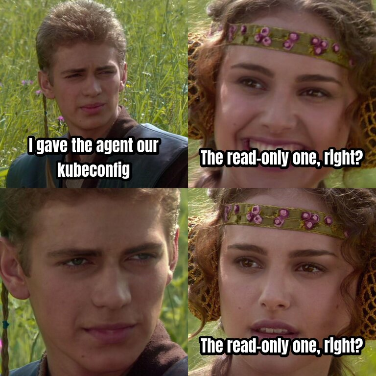
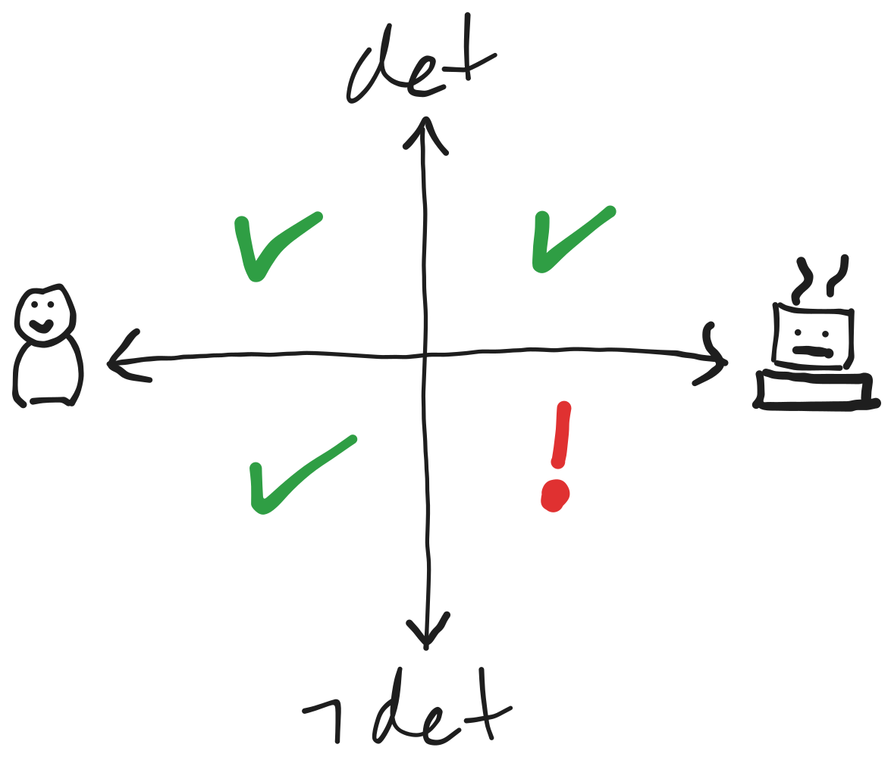
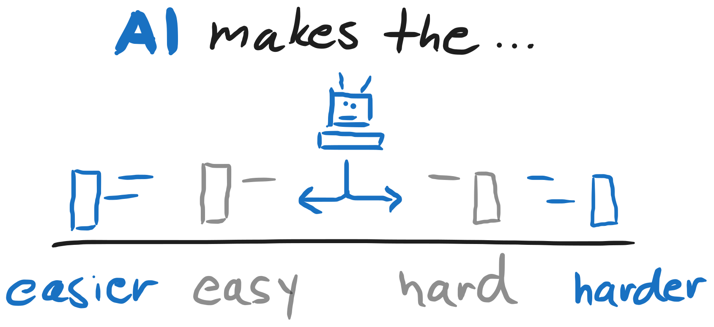

<!-- .slide: class="title-slide" -->

<div class="title-container">
  <div class="logos">
    
  </div>
  <h1 class="title">Agentic Engineering</h1>
  <span class="subtitle">Infrastructure Track, Part 1<br>Basics · Determinism · Steering · Sharing · Debugging</span>
  <span class="meta">HIVEMIND · 5 November · half-day 1 of 2</span>
</div>

---

## Read-only, right?



<p class="credit">Star Wars, Lucasfilm</p>

---

## Before we start

Run this now, before the first exercise:

```sh
git clone https://github.com/HivemindTechnologies/agentic-engineering-workshop-infrastructure.git
cd agentic-engineering-workshop-infrastructure/workbench
nix develop
just up
```

---

<!-- .slide: class="poll" -->

## How far does your agent go today?

1. **Chat** I ask, I read the answer
2. **Copy-paste** it suggests commands, I run them and paste back
3. **Approve** it runs commands, I approve each one
4. **Alone** it runs commands without asking

Chat: the highest number you do.

---

<!-- .slide: class="poll" -->

## Does an agent read production?

`kubectl`, Grafana, logs

Answer under Reactions: ✅ Yes or ❌ No.

---

<!-- .slide: class="poll" -->

## Did an agent reach something it should not?

A file, a cluster, a key outside its task

Answer under Reactions: ✅ Yes or ❌ No.

---

<!-- .slide: class="poll" -->

## Have you sandboxed an agent?

nono, Docker Sandboxes, a devcontainer

Answer under Reactions: ✅ Yes or ❌ No.

---

<!-- .slide: class="poll" -->

## Does Git deploy your changes?

A merge triggers the deploy; nobody runs `kubectl apply`, `terraform apply` or `helm upgrade` by hand

Answer under Reactions: ✅ Yes or ❌ No.

---

<!-- .slide: class="poll" -->

## Did `just up` succeed?

The command from “Before we start”. Did it run without errors?

Answer under Reactions: ✅ Yes or ❌ No.

---

## The new quadrant



---

## How this works

- 💡 theory, 🛠️ you do it, 💬 we discuss
- Every exercise runs on your laptop, in `workbench/`
- Open `exercises/part1.md` now: one section per 🛠️ slide
- Questions any time, aloud or in the chat

---

## Timetable

<div class="timetable">
<p class="tt-today">Part 1, today: four sessions of 50 minutes</p>
<ol class="tt-rail">
<li class="tt-stop"><b>Basics</b><span>Harness · sandbox · setup</span></li>
<li class="tt-break">☕ break, 10 minutes</li>
<li class="tt-stop"><b>Basics · Determinism</b><span>Secrets · variance · GitOps · rollback</span></li>
<li class="tt-break">☕ break, 20 minutes</li>
<li class="tt-stop"><b>Determinism · Steering</b><span>Spec · quality gate · context · skills · files · subagents</span></li>
<li class="tt-break">☕ break, 10 minutes</li>
<li class="tt-stop"><b>Sharing · Debugging</b><span>Plugins · sharing a skill · MCP · debug MCP · debugging agent · your questions</span></li>
</ol>
<p class="tt-legend">💡 theory · 🛠️ you do it · 💬 we discuss</p>
</div>

---

## Easy easier, hard harder



<!-- lessons: the menu, in order. `== <title>` opens a part (one half-day),
     `-- <title>` a block inside it, with its own divider slide.
     `~~ Break` ends a 50-minute session with a break slide.
     Every other line is one lesson id.
     Comment a line (leading #) to skip it.
     Blocks group lessons by what you do with the agent; breaks follow the
     sessions, so a break may fall inside a block (Secrets opens session 2).
     Safe to skip live, because no later lesson uses what they produce:
     files1, subagents1, mcp1, plugin1, share1.
== Part 1
-- Basics
harness1
sandbox1
setup1
~~ Break
secrets1
-- Determinism
variance1
gitops1
rollback1
~~ Break
spec1
qualitygate1
-- Steering
context1
skills1
files1
subagents1
~~ Break
-- Sharing
plugin1
share1
-- Debugging
mcp1
debug1
debugagent1
-->

---

## Questions?

<!-- The agenda again: each lesson as the habit it replaces, struck through, and its replacement. -->
<div class="agenda closing">
<div class="agenda-col"><p class="agenda-block">Basics</p><ul>
<li><s>Model</s> Harness</li>
<li><s>Approve</s> Sandbox</li>
<li><s>Agent decrypts</s> You decrypt</li>
</ul></div>
<div class="agenda-col"><p class="agenda-block">Determinism</p><ul>
<li><s>Short prompt</s> Interview</li>
<li><s>kubectl apply</s> git push</li>
<li><s>Hotfix</s> Revert</li>
<li><s>Vague request</s> Spec</li>
<li><s>Advice</s> Quality gate</li>
</ul></div>
<div class="agenda-col"><p class="agenda-block">Steering</p><ul>
<li><s>Weights</s> Context</li>
<li><s>Habit</s> Skill</li>
<li><s>Chat</s> File</li>
<li><s>One window</s> Two</li>
</ul></div>
<div class="agenda-col"><p class="agenda-block">Sharing</p><ul>
<li><s>One laptop</s> Team</li>
<li><s>Silent edit</s> Pull request</li>
</ul><p class="agenda-block">Debugging</p><ul>
<li><s>Copy-paste</s> Tool call</li>
<li><s>Read the logs</s> Ask the pod</li>
<li><s>Claim</s> Proof</li>
</ul></div>
</div>
